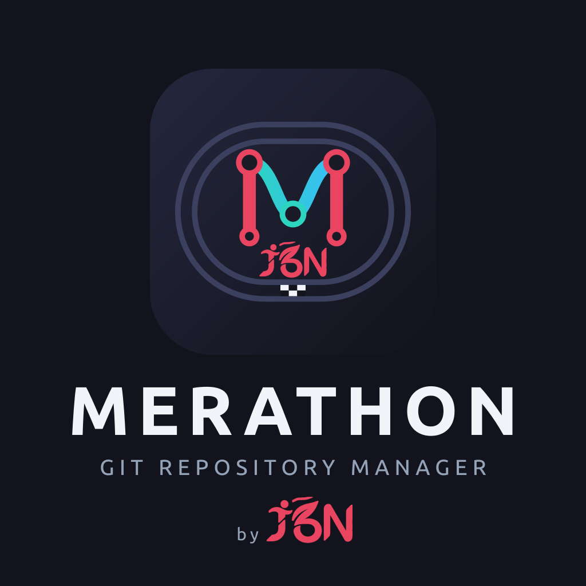

<p align="center">
  
</p>

<h1 align="center">Merathon — Git Repository Manager</h1>

<p align="center"><a href="README.fr.md">Français</a> · <strong>English</strong></p>

<p align="center"><em>"Your code is a marathon."</em></p>

<p align="center">
  Desktop graphical Git client, built with <strong>Tauri 2</strong> (Rust backend + <code>git2</code>)
  and <strong>React 19 / TypeScript</strong> (Vite + Tailwind + Zustand frontend).
</p>

<p align="center">
  
</p>

## Why "Merathon"?

- **Merge + marathon**: the word is instantly understood, it raises a smile and it sticks.
- It tells the story of the job: a project is a marathon made of merges.
- It sounds the same in French and English, and takes a second to say: "I use Merathon".
- The logo follows the same idea: an **M** drawn as a Git graph (a branch that leaves and then merges) in the middle of an athletics track, with its finish line. The author's **J6N** signature, the lettering of the original logo, runs under the M.

## Installation

Packages for each version are published in the [GitHub releases](https://github.com/J-Dudek/merathon/releases/latest):

- **Linux**: `.deb` (Debian/Ubuntu) or `.AppImage` (universal). The `.deb` package automatically replaces the old `j6n` package.
- **Windows**: `.msi` or `.exe`. The installers are not signed yet: on first launch, click **More info** then **Run anyway**.

The SHA-256 checksums of all files are in `SHA256SUMS.txt`. Once installed, the application updates itself.

### Minimum requirements

| | Linux | Windows |
| --- | --- | --- |
| **System** | Ubuntu 22.04, Debian 12, or any distribution with **glibc ≥ 2.35** | Windows 10 or 11 |
| **Architecture** | x86_64 (amd64) | x86_64 (64-bit) |
| **Web engine** | WebKitGTK 4.1 (`libwebkit2gtk-4.1-0`) and GTK 3 (`libgtk-3-0`), installed automatically with the `.deb` | [WebView2](https://developer.microsoft.com/microsoft-edge/webview2/): already present on Windows 11, downloaded by the installer on Windows 10 if missing |

On Linux, older versions are not supported: Ubuntu 20.04, for example, does not provide `libwebkit2gtk-4.1-0`, and installing the `.deb` fails with "Depends: libwebkit2gtk-4.1-0 but it is not installable". The AppImage has the same glibc requirement. On WSL with a distribution that is too old, the simplest option is to install the Windows version. On WSL (WSLg), Merathon displays through X11 so that the Windows taskbar shows its icon rather than the penguin; `GDK_BACKEND=wayland merathon` forces Wayland. It also switches WebKitGTK to software rendering (`WEBKIT_DISABLE_DMABUF_RENDERER=1`, `LIBGL_ALWAYS_SOFTWARE=1`): depending on the GPU and its Windows driver, accelerated rendering leaves areas undrawn, such as white rectangles on the graph. A variable that is already set is respected: `LIBGL_ALWAYS_SOFTWARE=0 merathon` turns hardware acceleration back on.

Versions up to and including 2.0.0 require glibc ≥ 2.39 (Ubuntu 24.04, Debian 13): on an older system, the package installs but the application does not start ("version `GLIBC_2.39' not found").

### WSL repositories opened from the Windows version

> [!WARNING]
> The Windows version can open a repository located in WSL (`\\wsl.localhost\<distribution>\…`), but it will be **noticeably slower** there than on a Windows disk. This is normal: each file read crosses the boundary between Windows and the WSL virtual machine (9P protocol), and displaying the state of a repository requires examining each of its files. For WSL repositories, prefer the Linux version launched in WSL: it reads the disk directly.

Seen from Windows, these repositories belong to another user: Git refuses to open them until they are declared safe (`safe.directory`). On the first opening, Merathon offers to trust them and adds the entry to the global Git configuration (`%USERPROFILE%\.gitconfig`).

## Features

- **Repositories and tabs**: open, initialize, clone (with the list of your accounts' repositories), recent repositories. Each repository opens in a **tab**; pull, push, fetch… apply to the displayed tab, which keeps its state (selection, diff, commit message in progress) when you switch to another one. A repository that is already open is simply displayed again, and tabs are reopened at startup. Several windows remain possible.
- **Integrated terminal**: collapsible panel under the graph (Ctrl+J), with a real shell opened in the folder of the tab's repository. The graph and the status refresh by themselves after each command.
- **Operation log**: next to the terminal, each action of the application (commit, pull, push, rebase, stash…) is displayed as the equivalent `git` command, with its status, its duration and the full error message on failure. Credentials contained in a URL are never displayed.
- **History**: graph of all branches (local, remote, tags), search, commit detail (message, author, modified files) and diff of each file. Each point of the graph carries the author's initials, with the name shown on hover. Select several commits with Ctrl+click (or Cmd+click) and Shift+click for a range, then right-click → **Squash the selected commits**: they are merged into the oldest one, with an editable message (pre-filled with the original messages).
- **Working copy**: stage / unstage / discard by file, by hunk or line by line from the diff (click, Shift+click for a range), commit with summary + description, amend. Right-click an untracked file → **Add to .gitignore**: the file itself, all files with its extension (`*.log`) or its folder; with several files selected, they are added at once. The pattern is written to the `.gitignore` at the root of the repository (created if needed), without duplicates.
- **Branches**: creation, checkout (including a remote branch with tracking, or a commit in detached HEAD), renaming, deletion, tracked branch, ahead/behind. A `local` badge marks, in the sidebar and on the graph, branches that exist on no remote, and a `PR #12` (or `MR !12`) badge those with an open pull / merge request. Several local branches can be selected (Ctrl+click, Shift+click) and deleted at once.
- **Integration**: merge (fast-forward or merge commit), rebase, cherry-pick, revert, reset soft/mixed/hard, with conflict resolution and continue / abort.
- **Right-click in the graph**: on a branch label, the same menu as in the sidebar (checkout, merge, rebase, fast-forward, push, PR / MR, rename, delete…). On a commit carrying another branch, its main actions at the top of the menu: checkout of the branch (not of the commit in detached HEAD), merge and rebase by its name, fast-forward when possible: the current branch up to this branch, or this branch up to the current branch or up to its tracked remote branch, without checking it out (like `git fetch . origin/main:main`). Actions that make no sense on a commit already contained in the current branch (cherry-pick, merge, rebase) are disabled, and interactive rebase is only offered from an ancestor of HEAD. With several commits selected (Ctrl + click, Shift + click): cherry-pick of all of them, from oldest to newest (stops at the first conflict, with the list of remaining commits), and comparison of two commits (files modified from one to the other in the right panel, diff of each file in the center). On the last commit of the current branch: edit its message (without adding staged files), amend (opens the commit panel in amend mode, message pre-filled) and undo the commit (its changes stay staged, message restored to the draft), with a warning if the commit has already been pushed.
- **Solo / hide branches** (branch menu, in the graph or the sidebar): show only certain branches (solo, can be combined) or hide some, with their own commits; the history they share with the displayed branches remains visible. A banner above the graph recalls the filter and lets you show everything again; in the sidebar, branches outside the graph are grayed out and those in solo are marked. The filter is remembered per repository. The current branch cannot be hidden.
- **Interactive rebase** (right-click a commit): reorder (drag and drop or arrows), rename, edit (stop to amend or add commits), squash / fixup or delete commits. With merges in the history, your choice: *flatten* (like `git rebase -i`) or *preserve merges* (like `--rebase-merges`: shape kept, merge conflict resolutions kept). The rebase stops on a conflict to resolve then "Continue", and can be aborted at any time to return exactly to the initial state; the old position remains accessible via `ORIG_HEAD`. As with git, a commit that has become empty (its changes are already present) is skipped.
- **Submodules**: list and state, recursive initialization / update (with account credentials), automatic retrieval after a clone, opening in a new tab or a new window.
- **Git LFS** (requires [git-lfs](https://git-lfs.com)): LFS files are staged via `git add` (pointer, not the binary), LFS objects are sent before each push and retrieved after clone / pull / checkout; pattern tracking, list of files not downloaded.
- **Remotes**: fetch, pull (merge or rebase), push (optionally forced), remote branch deletion, adding / removing remotes.
- **Automatic synchronization**: every 5 minutes (interval adjustable in the preferences, or can be disabled), each repository open in a tab is fetched and its open PRs / MRs are reloaded. A notification summarizes what changed: new, updated or deleted remote branches, PRs opened or closed, new commits or comments on a PR already viewed. Synchronization stays silent on error (offline, access denied) and waits for an ongoing operation to finish (pull, push…). The ⟳ button next to the branch name, in the toolbar, starts it on demand (it spins during each synchronization, automatic or not).
- **PR / MR notifications**: at each synchronization, the PRs / MRs to handle (assigned or review requested) and those I opened, across all projects, are compared to the previous list (including that of the previous session). Reported: a new PR / MR to handle, new commits (except on my own PRs), new comments, CI passed or failed, an approval or requested changes. When Merathon is in the background or minimized, this is a system notification (Windows, macOS, Linux), grouped if there are several PRs; otherwise, a simple banner. On WSL, without a Linux notification server (the default case, as WSLg does not relay them), Merathon displays a Windows notification via `powershell.exe`, under the name of Windows PowerShell. On Linux, a notification is removed from the system list as soon as all the PRs it mentions have been viewed in Merathon (the Ubuntu dock shows their number on the icon). A badge on the application icon indicates the number of PRs / MRs with something new: modified since their last viewing, or to handle and never opened. It appears on the Dock (macOS), as an overlay icon in the taskbar (Windows), in the window icon displayed by the Windows taskbar (WSL) and in launchers that support it (KDE, Ubuntu dock, Dash to Dock). It decreases as PRs are viewed. A dot on the tab of an open repository indicates that these PRs / MRs concern it (the number is in the tooltip); it disappears when they have all been viewed. Each type of event, and the badge, can be disabled in the preferences, which also offer a test notification. Nothing arrives when the application is closed.
- **Tags and stash**: lightweight or annotated tags (creation, push, deletion), stash (with untracked files), apply, pop, drop.
- **Accounts**: GitHub, GitLab.com and self-hosted GitLab, by browser login (OAuth, see below) or personal token. The token is validated when added then stored in the system keychain (Secret Service, Keychain, Credential Manager). Failing a keychain, it is written to `tokens.json` (mode 600) in the app's configuration folder. The account whose host matches the remote is used automatically for clone / fetch / pull / push over HTTPS; over SSH, the agent then the `~/.ssh` keys are used. The **Accounts** tab also lists the PRs / MRs of all projects (see below) and the open issues of the current repository.
- **Git identity**: name and email, global or specific to the repository.
- **Git profiles** (Preferences → Git profiles): one configuration per folder, for example `~/dev/pro` with a GitLab account, `~/dev/client` with a self-hosted instance and `~/dev/perso` with GitHub. Each profile defines the name and email of commits, the associated account and an SSH key, existing or created for the occasion, and can register this key on the account. Profiles rely on the native `includeIf "gitdir:…"` rule of `~/.gitconfig`, so command-line `git` follows them too; only the `~/.gitconfig-merathon-*` files and their rule are modified, rules written by hand are listed and kept, and a copy of `~/.gitconfig` is kept before each write. Fetch, pull, push, clone, submodules and LFS use the key of the folder's profile; over HTTPS, the token is still chosen according to the instance. The **Accounts** tab indicates the profile of the open repository, an alert above the commit summary reports a repository that would sign with an email other than its profile's, and clone offers the folder of the profile linked to the account. Overlapping folders are refused.
- **SSH setup** (**Accounts** tab, right-click an account → "Set up SSH…"): reuses a key from `~/.ssh` (`id_ed25519`, `id_ecdsa`, `id_rsa`) or creates `~/.ssh/id_ed25519`, with an optional passphrase, without ever overwriting an existing file; registers it on the GitHub or GitLab account; checks the server fingerprint (compared to the one published for github.com and gitlab.com, to be validated by yourself for another instance); then tests the connection and reports if the key belongs to another account. If the token does not have the right to add keys (GitHub: `write:public_key` scope), Merathon offers to copy the public key and opens the forge's page. Remotes are not modified: repositories over HTTPS keep using the token. `~/.ssh/config` is never modified, and only one account per host is supported for now. Key creation works without OpenSSH, but checking the connection needs it.
- **Worktrees**: the **Worktrees** section of the sidebar lists the repository's working copies with their branch. The + button creates one on a new branch, a local branch's menu checks it out into a new worktree (by default in a neighboring folder, `<repository>-<branch>`). A click opens the worktree in a tab; a branch checked out elsewhere cannot be checked out, moved or deleted, and its menu leads to its worktree. Deletion removes the folder and warns if changes remain; the branch is kept. The submodules of a new worktree are initialized from its tab. How it works is explained in the **Git Cheat Sheet**, Worktrees section. A branch name incompatible with an existing branch (`toto/a5` when `toto` exists) is refused with an explicit message, on creation as on renaming.
- **Preferences** (Ctrl+,): interface language (French by default or English, asked on first launch), light or dark theme or the system's (followed live), size of the whole interface from 80 to 200% (Ctrl+= / Ctrl+- / Ctrl+0), terminal text size, graph density (compact, normal, comfortable), automatic synchronization interval (with a "Synchronize now" button), PR / MR notifications by event type and list of keyboard shortcuts. Settings apply immediately to all windows.
- **Git Cheat Sheet** (Merathon menu → "Git Cheat Sheet"): a reference of git operations, sorted by section (changes, branches, synchronization, integration, rewriting history, stash, tags, worktrees, submodules and LFS…). Each card gives the equivalent command, what it does, a concrete use case, the steps to follow in the application and, where relevant, a warning (data loss, rewritten history). A search filters all the cards.
- **Automatic updates**: at startup, the application checks whether a new release exists, offers to install it while listing what's new in all versions published since the installed one, then restarts (also via the Merathon menu → "Check for updates…"). Packages are signed and the signature is verified before any installation (AppImage, `.deb`, `.exe`, `.msi`).

### Pull requests and merge requests

With a GitHub or GitLab account matching a remote of the repository, PRs (GitHub) and MRs (GitLab) are managed without leaving the application:

- **List**: in the repository sidebar, under the remote branches. Filters by state (open, merged, closed, all) and by person (mine, to review by me, assigned to me). Right-click: checkout of the branch, opening in the browser, mark as read / unread.
- **Read and unread**: a PR never opened is in bold with a blue dot; once its detail has been viewed, it is grayed out. If it then changes, a label says so: `commits` (new push), `comments` or `activity` (review, label…). The branch badge also carries a dot as long as one of its PRs is unread. This tracking is stored locally, and forgotten as soon as the PR is merged, closed or deleted.
- **All projects** (**Accounts** tab): for each account, the PRs / MRs **to handle** (assigned or review requested), grouped by project, and **mine** with their state: draft, conflicts, changes requested, CI failed, awaiting review or approved, plus a CI indicator. They open in the same detail panel, including for a project that is not cloned (the modified files tab and checkout then ask you to open the repository).
- **Creation**: right-click a branch → **Create a GitHub pull request…** (or **GitLab merge request…**): target branch, title, description, reviewers, assignees, labels, milestone, draft, squash and source branch deletion (GitLab), with a prior push of the local branch if needed. The description is pre-filled with the repository's template, as on the forge: `pull_request_template.md` (in `.github/`, at the root or in `docs/`) on GitHub, the "Default" template from `.gitlab/merge_request_templates/` (or the one from the project settings) on GitLab. Other templates are picked from a list.
- **Link an issue** (creation form): typing `#` in the description suggests the project's open issues, filtered by number or by a word of the title, ignoring case and accents. Other issues, including closed ones, are searched on the forge. **Enter** inserts `#12`, **Shift+Enter** inserts `Closes #12`, which GitHub and GitLab understand as "close the issue on merge". If the branch name contains an issue number (`feat/12-…`, `fix/issue-12`, `gh-12`) and the issue is open, a banner offers **Close on merge**.
- **Detail** (click a PR or a branch's badge): description, reviewers and their verdict, required approvals (GitLab), status of each CI job, conversation. The description and comments, including those on code lines, are displayed in Markdown (tables, task lists and common HTML included, without scripts or active content), with emojis, written directly or as code like `:tada:`. Links open in the browser. Images are not loaded, because the interface has no network access: each one becomes a link to its source.
- **Insert an emoji** (description, comments, commit message): typing `:` followed by a word suggests matching emojis, in English as on the forge (`:rocket`) or, for the most common ones, in French (`:fusee`, `:coeur`), ignoring accents. **Enter** or **Tab** inserts the emoji. The button on the right of the field opens a picker with search, recent emojis and categories.
- **Edit the title and description** (PR / MR author only): **Edit**, above the description, opens a form where `#` also suggests issues. **Ctrl+Enter** saves. On GitLab, the "Draft:" prefix does not appear in the editable title, and the draft status is kept. Closing the window with unsaved changes asks for confirmation.
- **Actions**: comment; approve, request changes (GitHub) or withdraw your approval (GitLab); switch from draft to ready and back; update the branch with the target (merge on GitHub, rebase on GitLab); merge according to the modes allowed by the repository (merge commit, squash, rebase), after confirmation and only if the branch has not moved in the meantime; close or reopen. When the merge is blocked, the reason is displayed (conflicts, CI, approvals, draft, permissions…).
- **Behind the target branch** (repository open locally): when opening a PR, the remote is fetched and the panel indicates whether the branch is up to date or N commits behind its target. **Rebase onto …** replays its commits on top of the target, in memory: neither the working copy nor the local branches move. The resulting history is linear, without merge commits, and commits already present in the target are removed, as with `git rebase`. On a conflict, nothing is modified and the panel offers to check out the branch to rebase by hand. Otherwise, **Force push** replaces the remote branch, with the safety of `git push --force-with-lease`: the push is canceled if someone pushed in the meantime. The local branch of the same name follows if it was at the old head. Not available for a PR coming from a fork.
- **Modified files**: PR diff computed locally with git, from the common ancestor with the target branch (a fetch is run if commits are missing). The forge's line comments are displayed under their lines, with replies and thread resolution.
- **Review**: hover over a line then **+** to comment on it, immediately or as pending. **Finish review** publishes the pending comments with a general comment and a verdict (comment, approval, change request on GitHub). On GitHub, the review is published all at once; on GitLab, comment by comment, those that fail remaining pending.
- **Threads handled by a commit**: when the current branch has an open PR, **Link review threads…** under the commit message lists its line comments. For each thread, choose **Reply** or **Reply and resolve**. The choice is written as a trailer at the end of the message (`Resolves-Thread: <id>` or `Addresses-Thread: <id>`). After a push from Merathon, each thread cited by the pushed commits receives a "Handled in `<sha>`" reply (the forge turns it into a link to the commit), then is resolved if requested. There is only one reply per thread, even after a rebase and a new push. Trailers are kept by an amend and grouped at the end of the message by a squash.
- **Viewed files**: each file can be ticked "viewed" as the review progresses (automatic move to the next one), with a counter. This tracking is stored locally and starts again from zero at the next push.

Limits: PRs coming from a fork are not retrieved by the remote's fetch (their diff must then be viewed in the browser), and the list is limited to the 50 most recent PRs (50 per category in the **Accounts** tab), comment threads to the first 100. On GitHub, a review verdict without a line comment counts as `activity`, not as a comment.

### Keyboard shortcuts

| Action | Shortcut |
|---|---|
| Open a repository | <kbd>Ctrl</kbd>+<kbd>O</kbd> |
| New tab / close tab | <kbd>Ctrl</kbd>+<kbd>T</kbd> / <kbd>Ctrl</kbd>+<kbd>W</kbd> |
| Next / previous tab | <kbd>Ctrl</kbd>+<kbd>Tab</kbd> / <kbd>Ctrl</kbd>+<kbd>Shift</kbd>+<kbd>Tab</kbd> |
| New window | <kbd>Ctrl</kbd>+<kbd>Shift</kbd>+<kbd>N</kbd> |
| Show / hide the terminal and log | <kbd>Ctrl</kbd>+<kbd>J</kbd> |
| Zoom in / zoom out / default size | <kbd>Ctrl</kbd>+<kbd>=</kbd> / <kbd>Ctrl</kbd>+<kbd>-</kbd> / <kbd>Ctrl</kbd>+<kbd>0</kbd> |
| Preferences | <kbd>Ctrl</kbd>+<kbd>,</kbd> |
| Refresh the repository | <kbd>F5</kbd> |
| Copy / paste in the terminal | <kbd>Ctrl</kbd>+<kbd>Shift</kbd>+<kbd>C</kbd> / <kbd>Ctrl</kbd>+<kbd>Shift</kbd>+<kbd>V</kbd> |

When the terminal has focus, keys go to the shell (Ctrl+R, Ctrl+W, Esc…).

The application's code is in the [`git-client/`](git-client/) folder.

## Technical choices

A desktop Git client must be **fast on large histories**, **safe** (it handles tokens and repositories you don't always know), **light** (it stays open all day, next to the IDE) and **cross-platform**. Each building block was chosen for one of these constraints.

### Tauri 2 rather than Electron

- **Light**: Tauri uses the system's web engine (WebKitGTK on Linux, WebView2 on Windows) instead of embedding Chromium and Node.js. The `.deb` package weighs about 8 MB, whereas an Electron application often exceeds 80 MB. Memory used at rest is also much lower, which matters for a tool you never close.
- **Safe by design**: the webview has no access to the system. It can only call the Rust commands declared one by one, with the permissions listed in `capabilities/`. A flaw in the interface therefore gives access neither to files, nor to the network, nor to tokens (see [Security](#security)).
- **Ready to use**: Linux and Windows installers, signed updates, multiple windows and native dialogs are provided by Tauri and its plugins, without in-house tooling.

### Rust and libgit2 (`git2`) for the Git engine

- **No parsing of `git` output**: many clients run the `git` command and read its text, which varies with version, language and configuration. libgit2 gives direct, typed access to objects, the index and references: status, diff, graph, rebase or line-by-line patch are computed without an intermediary.
- **Performance**: reading thousands of commits or computing a diff is done in native Rust, off the interface thread (`spawn_blocking`). The interface stays fluid during a fetch or a rebase.
- **Safety with unknown repositories**: libgit2 runs neither hooks, nor filters, nor commands defined in a repository's configuration. Cloning and opening a malicious repository therefore launches nothing. The only call to `git` (for Git LFS, which does not exist in libgit2) explicitly neutralizes these mechanisms.
- **Code reliability**: Rust's strict typing and explicit error handling (`Result`, `thiserror`) prevent crashes in the middle of an operation that modifies the repository. Sensitive operations (interactive rebase, merge, patch) are covered by tests on real temporary repositories.
- **Tokens on the Rust side only**: calls to the GitHub / GitLab APIs (`ureq` + `rustls`) and storage in the system keychain (`keyring`) are done in the backend. The token is never passed to the interface.

### React 19, TypeScript and Vite for the interface

- **A highly interactive interface**: graph, diff, staging, PR review, context menus, interactive rebase drag and drop… React, with its components and declarative rendering, is made for these constantly changing screens.
- **TypeScript**: the data exchanged with Rust (commits, status, PRs…) is typed on both sides (`src/types/`). An inconsistency shows up at compile time, not at the user's.
- **Vite**: instant hot reload in development and an optimized production build.
- **Graph drawn in a `<canvas>`, and only its visible part**: the lines and points of the history do not each create a DOM element, so scrolling stays fluid whatever the size of the displayed graph.

### Zustand for state, Tailwind for style

- **Zustand**: a simple global state, without the ceremony of Redux. Each repository tab keeps its state (selection, diff, commit draft) and each component only re-subscribes to what it displays, which limits unnecessary renders.
- **Tailwind CSS**: style is written next to the component, with consistent colors and sizes. The shipped CSS contains only the classes actually used.

### The rest of the tooling

- **xterm.js + `portable-pty`**: a real terminal (the same engine as VS Code's) connected to a native pseudo-terminal, on Linux as on Windows.
- **Vitest, ESLint (SonarJS), Clippy, `cargo test`, `npm audit` / `cargo audit`**: the same verification chain locally and in CI, on every push.
- **Conventional Commits and automatic releases**: the version, the changelog, the signed packages and the automatic update all derive from commit messages, without a manual step.

### The trade-offs we accept

- **System web engine**: WebKitGTK and WebView2 do not render exactly alike. The interface therefore avoids very recent web features, and CI runs the tests on Linux and on Windows.
- **libgit2 does not cover all of Git**: Git LFS goes through the `git` command (which must then be installed), and some advanced Git options have no equivalent.
- **Two languages**: Rust and TypeScript require two skill sets. In return, each does what it does best: Rust safety and performance, TypeScript the interface.

## Development prerequisites

- **Node.js** 22.12+ and npm
- **Rust** stable (via [rustup](https://rustup.rs/))
- Tauri's system dependencies:

  **Linux (Debian/Ubuntu)**

  ```bash
  sudo apt-get update
  sudo apt-get install -y \
    pkg-config libssl-dev libgit2-dev libdbus-1-dev \
    libwebkit2gtk-4.1-dev libgtk-3-dev \
    libayatana-appindicator3-dev librsvg2-dev
  ```

  **Windows**: Microsoft C++ Build Tools and WebView2 (preinstalled on Windows 10/11).

- Optional: [git](https://git-scm.com) and [git-lfs](https://git-lfs.com) in the `PATH` for repositories using Git LFS.
  See the [Tauri docs](https://v2.tauri.app/start/prerequisites/) for other platforms.

## Security

- **Tokens**: stored in the system keychain; they never leave the Rust backend (calls to the GitHub / GitLab APIs, REST as well as GraphQL, are made on the Rust side, the interface has no access to tokens). The interface can only request reads, creations and updates: any deletion request (`DELETE`) is refused on the Rust side, and API paths are validated to target only the account's server. Without an available keychain, falls back to a `tokens.json` file (mode 600) with a warning.
- **Sending credentials**: only to the account's server and over HTTPS (not after a redirect to another host, not to a third-party LFS server declared by a repository). Instances must use HTTPS (HTTP accepted only for `localhost`).
- **Untrusted repositories**: libgit2 runs no command defined by a repository; the few calls to `git` (Git LFS) enforce their settings (no hooks, fsmonitor, helpers or filters defined by the repository's local configuration).
- **Interface**: strict CSP (local scripts only, no network access from the webview), `freezePrototype`, file paths validated on the Rust side (no way out of the repository).
- **Integrated terminal**: it launches the user's shell, with their rights, like a regular terminal; its processes are stopped when the tab or window closes.
- **Dependencies**: `npm audit` and `cargo audit` run at each CI.

## OAuth login

Browser login uses the *device flow*: the application displays a code to enter on the forge. It contains no secret, but needs the client ID of a registered OAuth application:

- **GitHub**: *Settings → Developer settings → OAuth Apps → New OAuth App*, tick **Enable Device Flow** (the callback URL is not used).
- **GitLab** (gitlab.com or instance ≥ 17.2): *Preferences → Applications*, **non-confidential** application, scopes `api`, `read_user`, `write_repository`.

The ID is entered in the account creation form (it is remembered per instance), or provided by an environment variable, read when the application starts and, failing that, built in:

```bash
export MERATHON_GITHUB_CLIENT_ID=Ov23li...
export MERATHON_GITLAB_CLIENT_ID=abc123...
npm run tauri dev     # run from this same terminal
```

In CI, the release workflow builds into the binary the repository variables (or secrets) `MERATHON_GITHUB_CLIENT_ID` and `MERATHON_GITLAB_CLIENT_ID` (the old `GIT_CLIENT_…` names are still accepted, at launch as at build time).

GitLab tokens expire after 2 hours: they are renewed automatically thanks to the refresh token.

## Running locally

```bash
cd git-client
npm install
npm run tauri dev
```

`npm run tauri dev` starts the Vite server on `http://localhost:1420` then compiles and opens the Tauri application. The first launch is long (compiling the Rust crates); the following ones are incremental. The frontend hot-reloads, and changes to the Rust code trigger an automatic recompilation.

> Port 1420 must be free (`strictPort` is enabled in `vite.config.ts`).

> To use the application on its own repository (rebase, merge…), go through the installed version or run dev mode from a separate worktree (`git worktree add ../git-management-dev main`): a conflict writes `<<<<<<<` markers into the sources that Vite compiles, and the application under development no longer starts.

## Tests and checks

From `git-client/`:

```bash
npx tsc --noEmit      # TypeScript check
npm run lint          # ESLint: TypeScript, SonarJS and React hooks rules
npx vitest run        # frontend tests (Vitest + Testing Library)
npm run check:i18n    # translations: also run by npm run build, which fails if any are missing
```

New interface text is written `tr("Texte français")`, with its translation in `src/i18n/en.ts` (the French source text is the key); on the Rust side, `tr!("Texte français", "English text")`.

From `git-client/src-tauri/`:

```bash
cargo clippy -- -D warnings   # Rust lint
cargo test                    # Rust tests
```

These are the same steps as the CI (`.github/workflows/ci.yml`).

## Production build

```bash
cd git-client
npm run tauri build
```

Installers are generated in `git-client/src-tauri/target/release/bundle/` (`.deb` / `.AppImage` on Linux, `.msi` / `.exe` on Windows).

## Continuous integration and releases

- **On pull requests**: Rust and frontend tests on Linux, lint, dependency audit (`.github/workflows/ci.yml`). A new push cancels the tests of the previous one, and a PR that only changes documentation (`*.md`, `docs/`) does not run them. Windows tests run on merge, with the release.
- **On each merge to `main`** (`.github/workflows/release.yml`):
  1. the same tests, on Linux and Windows, and, **in parallel**, computing the next version and generating the packages;
  2. version computed from commit messages since the last tag ([Conventional Commits](https://www.conventionalcommits.org)):
     - `feat!:` or `BREAKING CHANGE:` → major version,
     - `feat:` → minor version,
     - `fix:`, `perf:`, `refactor:`, `build:` or free-form message → patch,
     - only `docs:`, `ci:`, `test:`, `chore:`, `style:` → no release;
  3. generation of Linux (`.deb`, `.AppImage`) and Windows (`.msi`, `.exe`) packages with the new version applied (`package.json`, `package-lock.json`, `Cargo.toml`, `Cargo.lock`, `tauri.conf.json`), while the tests run; nothing is published yet;
  4. only if **the tests and all packages** succeed: `chore(release): vX.Y.Z` commit on `main`, `vX.Y.Z` tag and GitHub release, published automatically. The version commit is verified to be identical to the files the packages were generated from. If a test or a platform fails, nothing is tagged or published.

Since the `main` branch is protected, the version commit is pushed with the `RELEASE_TOKEN` secret: a token allowed to bypass the protection (GitHub App or *fine-grained* token limited to this repository, "Contents: read and write" permission).

To warn users about a particular point of a version (action to take after the update, name change…), add a `Release-Note: the message` line to a commit body. It appears at the top of the release notes, in an "À savoir" section, and therefore also shows in the application's update window.

Check the next version locally: `node git-client/scripts/version.mjs next`.

The repository's pull requests start from the [`.github/pull_request_template.md`](.github/pull_request_template.md) template (type of change, area concerned, CI checks).

The pull request's merge mode matters: with a **merge commit** or a **rebase**, all the commits of the branch are analyzed; with a **squash**, only the pull request title is (prefix it with `feat:` or `fix:` to trigger a release).

Automatic updates rely on a dedicated signing key: the public key is in `tauri.conf.json` (`plugins > updater > pubkey`), the private key and its password in the `TAURI_SIGNING_PRIVATE_KEY` and `TAURI_SIGNING_PRIVATE_KEY_PASSWORD` secrets. The build signs each package and publishes `latest.json`, the manifest the application reads. **If the private key is lost, installed versions can no longer be updated**: keep it in a password manager.

## Structure

```
git-client/
├── branding/            # Logo and icon sources (SVG) and J6N signature
├── src/                 # React frontend
│   ├── components/      # UI: Toolbar, TabBar, Sidebar, StagingPanel, BottomPanel (terminal / log),
│   │                    # PreferencesDialog, GitMemoDialog, DiffViewer, ConflictViewer, PullRequest* (list,
│   │                    # creation, review, modified files), MyPullRequests (PRs of all projects)…
│   ├── graph/           # Commit graph rendering
│   ├── store/           # Global state (Zustand): displayed repository, tabs, log, settings, read PRs…
│   ├── ipc/commands.ts  # Calls to Tauri commands (and log entries)
│   ├── lib/             # Git actions, periodic synchronization, PR state, terminals (xterm.js),
│   │                    # log commands, squash plan, review comments, threads linked to commits,
│   │                    # viewed files, .gitignore patterns, git cheat sheet content…
│   └── api/             # GitHub / GitLab clients (PR / MR, reviews, CI, templates) and common interface
└── src-tauri/           # Rust backend
    └── src/
        ├── lib.rs       # Tauri command registration
        ├── commands.rs  # Commands exposed to the frontend (network off the UI thread)
        ├── accounts.rs  # GitHub / GitLab accounts and token storage
        ├── forge.rs     # Calls to the GitHub / GitLab APIs (REST, GraphQL) with the account's token
        ├── oauth.rs     # OAuth login (device flow) and token renewal
        ├── terminal.rs  # Integrated terminal (pseudo-terminal, user's shell)
        ├── window.rs    # Multi-window management
        └── git/         # Git operations (git2): status, diff (including PR diff), patch (hunks), history, merge, rebase,
                         # interactive (rebase -i), stash, submodule, lfs, remote, auth…
```

## License

Distributed under the [MIT](LICENSE) license. The [Noto Color Emoji](https://github.com/googlefonts/noto-emoji) font embedded to display emojis is distributed under the [SIL Open Font License 1.1](git-client/public/fonts/NotoColorEmoji-OFL.txt).
