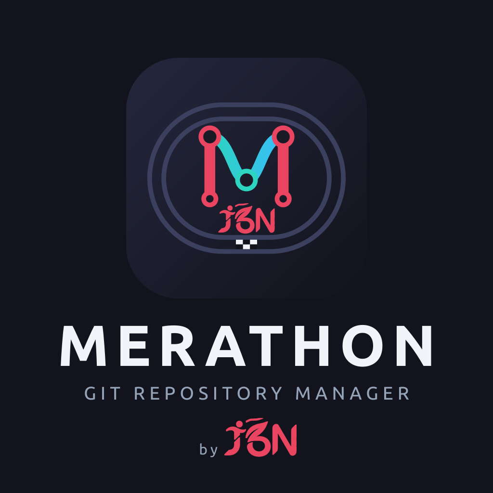

  

<h1 align="center">Merathon — Git Repository Manager</h1>

  <em>« Ton code, c'est un marathon. »</em> 
  <em>"Your code is a marathon."</em>

<h3 align="center">
  <a href="README.fr.md">🇫🇷 Documentation en français</a> · <a href="README.en.md">🇬🇧 English documentation</a>
</h3>

## Français

Merathon est un client Git graphique, libre, pour Linux, Windows et Android (téléphones et tablettes) : graphe de commits, onglets de dépôts, rebase interactif, worktrees, terminal intégré, et pull requests GitHub / merge requests GitLab, de la création à la revue, sans quitter l'application. Il est construit avec **Tauri 2** (Rust + `git2`) et **React 19 / TypeScript**, et son interface existe en français et en anglais.

[Télécharger la dernière version](https://github.com/J-Dudek/merathon/releases/latest) · [Lire la documentation complète](README.fr.md)

## English

Merathon is a free, open source graphical Git client for Linux, Windows and Android (phones and tablets): commit graph, repository tabs, interactive rebase, worktrees, integrated terminal, and GitHub pull requests / GitLab merge requests, from creation to review, without leaving the app. It is built with **Tauri 2** (Rust + `git2`) and **React 19 / TypeScript**, and its interface is available in English and French.

[Download the latest release](https://github.com/J-Dudek/merathon/releases/latest) · [Read the full documentation](README.en.md)

## Licence / License

[MIT](LICENSE)
