# SSH sur Android sans OpenSSH (issue #38)

État au 5 novembre 2026 :

- **Briques Rust** (PR #39) : prêtes et validées contre un vrai serveur OpenSSH.
- **Pont Android Keystore** : compilé par `tauri android build` et **vérifié sur l'émulateur** (Android 17, API 37, voir [plus bas](#vérifié-sur-lémulateur)), pas encore sur un vrai téléphone. Il reste donc derrière le réglage **Préférences > SSH > « Activer le SSH sur cet appareil »**, désactivé par défaut : sans lui, les garde-fous restent actifs et Android reste en HTTPS seulement.

Rien ne change sur Windows ni sur Linux : le bureau garde OpenSSH (`ssh-keyscan`, `ssh-keygen`, `ssh`), comme avant.

## Pourquoi le SSH échouait sur Android

libgit2 et libssh2 sont embarqués, mais `ssh_setup.rs` s'appuyait sur trois programmes d'OpenSSH absents d'Android :

| Fonction | Programme | Remplacé sur Android par |
|---|---|---|
| `scan()` (clé du serveur) | `ssh-keyscan` | `ssh_native::probe` : connexion libgit2, clé lue dans `certificate_check`, coupure avant toute authentification |
| `is_known()` | `ssh-keygen -F` | `known_hosts::is_known` / `known_hosts::lookup` (analyseur Rust) |
| `check_connection()` | `ssh -T` | `ssh_native::check_connection` : authentification libgit2 vers un dépôt inexistant |

Sans `known_hosts` rempli, libgit2 refuse la connexion avant même l'authentification (`invalid or unknown remote ssh hostkey`).

## Architecture

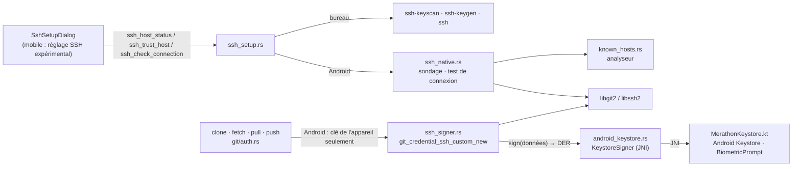

### Fichiers

| Fichier | Rôle | Compilé |
|---|---|---|
| `src-tauri/src/known_hosts.rs` | Lecture de `known_hosts` : hôtes en clair, listes, `[hôte]:port`, `*` `?` `!`, commentaires, `@revoked`. Les lignes hachées (`\|1\|…`) et `@cert-authority` sont ignorées (voir plus bas). | Android + tests |
| `src-tauri/src/ssh_native.rs` | Sondage de la clé du serveur, statut et validation de l'hôte, test de connexion, délais maximaux. | Android + tests |
| `src-tauri/src/ssh_signer.rs` | Piste 1 : clé qui ne sort jamais du coffre. FFI vers `git_credential_ssh_custom_new`, conversion de la signature DER au format SSH, interdiction des confirmations en arrière-plan (`without_prompt`). | Android + tests |
| `src-tauri/src/android_keystore.rs` | Pont JNI vers `MerathonKeystore.kt` : état, création, suppression de la clé, `KeystoreSigner`, messages traduits des erreurs du Keystore. | Android + tests (sans JNI) |
| `src-tauri/gen/android/app/src/main/java/com/gitclient/app/MerathonKeystore.kt` | Clé ECDSA P-256 non exportable, confirmation par empreinte ou code (30 s), API de la plateforme uniquement (24 à aujourd'hui). | Android |
| `src-tauri/src/test_sshd.rs` | Serveur OpenSSH jetable pour les tests (port libre, clés d'hôte et `authorized_keys` propres, `HOME` isolé). | tests |
| `src-tauri/src/ssh_setup.rs` | Branches `cfg(target_os = "android")` vers `ssh_native` et `android_keystore` (création de la clé dans le Keystore, jamais en fichier) ; le code du bureau est inchangé. | partout |
| `src-tauri/src/git/auth.rs` | `SshSources` : bureau = agent + clés `~/.ssh` + clé du profil (inchangé) ; Android = clé de l'appareil seulement, ni agent ni fichier. | partout |

Sur le bureau, `known_hosts.rs`, `ssh_native.rs` et `ssh_signer.rs` ne sont compilés que pour les tests : le binaire livré sous Windows et Linux ne contient pas ce code. Aucune crate n'est ajoutée à `Cargo.lock` (`base64ct`, `libc`, `ring`, `libgit2-sys`, `jni` 0.21 et `ndk-context` y étaient déjà, les deux derniers par tao).

## Choix techniques

### Piste 1 retenue côté Rust : la clé signe, elle ne se lit pas

`git2` n'expose pas `git_credential_ssh_custom_new` ; `ssh_signer.rs` le déclare lui-même, car le type du rappel dans `libgit2-sys` oublie sa valeur de retour (`int`), que libssh2 lit pour savoir si la signature a réussi. La signature est allouée avec `malloc` (libssh2 la libère avec `free`) et aucune panique ne traverse le code C.

**Algorithme : ECDSA P-256** (`ecdsa-sha2-nistp256`). C'est le seul que l'Android Keystore propose sur toutes les versions prises en charge (`minSdk = 24` ; Ed25519 n'y arrive qu'avec Android 13). GitHub, GitLab et OpenSSH l'acceptent. Le Keystore signe en `SHA256withECDSA` et rend une signature DER : elle est convertie en `mpint r, mpint s`, ce qu'attend libssh2.

Le pont Kotlin fournit deux choses :

```rust
pub trait SshSigner: Send + Sync {
    /// Point public P-256 non compressé (65 octets) ; `point_from_spki` le lit dans `PublicKey.getEncoded()`.
    fn public_point(&self) -> Vec<u8>;
    /// Signature SHA256withECDSA (DER) ; peut attendre la confirmation de l'utilisateur.
    fn sign(&self, data: &[u8]) -> Result<Vec<u8>, String>;
}
```

`android_keystore.rs` l'implémente (`KeystoreSigner`) en appelant `MerathonKeystore.kt` par JNI. `public_key_openssh` donne la ligne à ajouter sur la forge.

### Pont Android Keystore (`MerathonKeystore.kt`)

- **Création** : `KeyPairGenerator` EC `secp256r1` dans `AndroidKeyStore`, `PURPOSE_SIGN`, `DIGEST_SHA256`, `setUserAuthenticationRequired(true)`. Refusée sans verrouillage d'écran (`isDeviceSecure`), et jamais par-dessus une clé existante.
- **Validité d'une confirmation : 30 s**, pour enchaîner fetch puis push. API ≥ 30 : `setUserAuthenticationParameters(30, AUTH_BIOMETRIC_STRONG or AUTH_DEVICE_CREDENTIAL)` ; avant : `setUserAuthenticationValidityDurationSeconds(30)`.
- **Confirmation**, seulement quand la précédente a expiré (`UserNotAuthenticatedException`) : `BiometricPrompt` de la plateforme avec repli sur le code de l'appareil à partir d'Android 11 ; avant, l'écran de déverrouillage du système (`createConfirmDeviceCredentialIntent`) via un fragment sans vue. Pas de dépendance `androidx.biometric`.
- **Fils** : `sign()` est appelé dans le fil de libgit2 ; la confirmation s'affiche sur le fil de l'interface et ce fil de travail attend (`CountDownLatch`, 2 min au plus). Appelé depuis le fil de l'interface, `sign()` échoue au lieu de bloquer.
- **Arrière-plan** : la synchronisation automatique passe `background: true` à `fetch_remote` ; Rust appelle alors `sign(…, allowPrompt = false)`. Une clé verrouillée échoue en `locked` (marqueur `device-ssh-key-locked`), et `autoSync.ts` met le dépôt en pause avec **un seul** message par dépôt et par session.
- **Erreurs** : codes `absent`, `locked`, `cancelled`, `invalidated`, `insecure`, `exists`, `busy`, traduits par `android_keystore::describe`. Une clé invalidée (verrouillage retiré) se supprime dans Préférences > SSH, puis une nouvelle se crée avec « Configurer SSH… ».
- **R8** : la classe n'est appelée que par JNI ; `proguard-rules.pro` la garde. `MainActivity.onCreate` lui passe l'activité, au-dessus de laquelle la confirmation s'affiche.
- Avec une validité de 30 s, Android n'invalide pas la clé quand une nouvelle empreinte est enregistrée (seulement quand le verrouillage d'écran est retiré) : c'est le comportement documenté de `setInvalidatedByBiometricEnrollment`.

### Une confirmation par opération, jamais pour une clé inconnue du serveur

libssh2 demande d'abord au serveur si la clé est acceptée, sans signer. Une clé qui n'est pas sur la forge ne déclenche donc **aucune** confirmation (vérifié dans les tests). Une opération Git = une connexion = une signature.

### Vérification de l'hôte

- Le sondage ne propose aucune clé de l'utilisateur et coupe la connexion dès la clé du serveur reçue.
- Sans entrée dans `known_hosts`, libssh2 négocie **ECDSA** en premier (et non ed25519 comme `ssh-keyscan -t ed25519` sur le bureau). `PUBLISHED_FINGERPRINTS` contient donc les trois types publiés par GitHub et GitLab (ed25519, ECDSA, RSA). Un type non publié par ces forges est refusé, comme une empreinte différente.
- `trust_host` interroge à nouveau le serveur : seule l'empreinte validée par l'utilisateur est écrite, au format `[hôte]:port` hors port 22, et jamais par-dessus une clé déjà enregistrée.
- Clé d'hôte modifiée ou révoquée : connexion bloquée avant toute signature, sans proposer d'accepter la nouvelle clé.
- Pour un test de connexion, la vérification est double : celle de `known_hosts.rs`, puis celle de libssh2.
- Lignes hachées ignorées : sur Android, seul Merathon écrit ce fichier, toujours en clair. Une telle ligne fait traiter l'hôte comme inconnu (validation de l'empreinte), jamais comme accepté.

### Délais

Sondage : 8 s (comme `ssh-keyscan -T 8`). Test de connexion : 60 s, pour laisser le temps de confirmer. Au-delà, l'opération s'arrête et le fil abandonné ne demande plus aucune confirmation.

## Ce qui a été vérifié, et comment

Tous les tests tournent sur Linux contre **un vrai `sshd` OpenSSH** lancé par le test, avec une clé P-256 logicielle (`ring`) qui a la même interface et le même format DER que le Keystore :

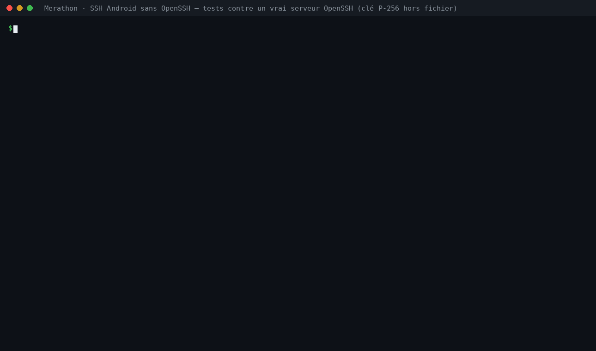

| Vérification | Test |
|---|---|
| Hôte inconnu : clone refusé avant toute signature | `git::auth::tests::clone_fetch_pull_and_push_over_ssh_with_the_device_key` |
| Empreinte lue par libgit2 = celle du serveur ; empreinte erronée refusée, rien d'écrit | `ssh_native::tests::setup_flow_against_a_real_openssh_server` |
| Après écriture de `known_hosts`, libgit2 passe l'étape de l'hôte | les deux tests ci-dessus |
| Clone, push, second clone, fetch + pull en SSH avec la clé de l'appareil | `clone_fetch_pull_and_push_over_ssh_with_the_device_key` |
| Authentification ECDSA réelle (`Accepted publickey … ECDSA` dans le journal de sshd) | `MERATHON_SSHD_LOG=1` |
| Confirmation refusée : opération arrêtée, message clair, serveur et dépôt local inchangés | les deux tests |
| Clé absente de la forge : refus clair, aucune signature | les deux tests |
| Clé d'hôte modifiée : connexion bloquée, rien proposé, `known_hosts` intact | `setup_flow_against_a_real_openssh_server` |
| Port muet (réseau coupé) : abandon après le délai | `probe_gives_up_after_the_timeout` |
| Aucune clé privée sur le disque (`~/.ssh` ne contient que `known_hosts`) | `clone_fetch_pull_and_push_over_ssh_with_the_device_key` |
| Signatures converties toujours valides (200 tirages), DER malformés refusés | `ssh_signer::tests` |
| Formats de `known_hosts` | `known_hosts::tests` |
| Bureau : liste des candidats d'authentification inchangée | `git::auth::tests` |
| Synchronisation en arrière-plan, clé verrouillée : aucune signature, échec reconnaissable, dépôt inchangé ; même pull à la main : passe | `clone_fetch_pull_and_push_over_ssh_with_the_device_key` |
| Confirmations interdites seulement dans `without_prompt`, propre à chaque fil | `ssh_signer::tests` |
| États et erreurs du Keystore traduits, description de la clé | `android_keystore::tests` |
| Garde-fous mobiles (clone, comptes, profils Git) et bureau inchangé | `src/components/AndroidSshGuards.test.tsx` |
| Réglage expérimental, section SSH des préférences, « Configurer SSH… » avec la clé de l'appareil | `src/components/DeviceSsh.test.tsx` |
| Synchronisation : dépôt SSH verrouillé ignoré, signalé une seule fois | `src/lib/autoSync.locked.test.ts` |

```bash
cd git-client/src-tauri
MERATHON_REQUIRE_SSHD=1 cargo test                       # échoue si sshd est introuvable (CI Linux)
MERATHON_SSH_DEMO=1 MERATHON_SSHD_LOG=1 cargo test -- \
  ssh_native::tests::setup_flow git::auth::tests::clone --nocapture   # récit étape par étape + journal de sshd
```

Sans `sshd` (Windows, poste sans OpenSSH), ces tests sont passés avec un message. La CI Linux installe `openssh-server` et pose `MERATHON_REQUIRE_SSHD=1`. Les tests de bout en bout tournent dans un processus enfant dont `HOME` est un dossier temporaire : libgit2 lit `~/.ssh/known_hosts` à partir de `HOME`, une fois par processus, et le `~/.ssh` du poste n'est jamais touché.

**Compilation Android** : la cible `aarch64-linux-android`, le NDK et le SDK Google n'étaient pas disponibles dans l'environnement de travail.

- Rust : les branches `cfg(target_os = "android")`, dont le JNI (`jni` 0.21), ont été vérifiées par `cargo clippy --lib -- -D warnings --cfg 'target_os="android"'` sur une copie du projet : aucune erreur ni avertissement.
- Kotlin : `MerathonKeystore.kt` compile sans avertissement (`kotlinc -Werror`) contre l'`android.jar` de l'API 23 (paquet Ubuntu `android-sdk-platform-23`), complété de bouchons écrits à la main pour les quelques symboles plus récents (`BiometricPrompt`, `setUserAuthenticationParameters`, `AUTH_*`). Leurs signatures reprennent la documentation Android, sans garantie de la plateforme.
- Ce n'était pas une vraie compilation : elle a été faite depuis avec `npx tauri android build --debug --apk --target x86_64` (voir ci-dessous).

## Garde-fous conservés sur mobile

Tant que le réglage « SSH (expérimental) » n'est pas coché, le SSH reste masqué sur Android (étape 8 de l'issue non réalisée, comme elle le demande) :

| Android | Bureau (inchangé) |
|---|---|
| 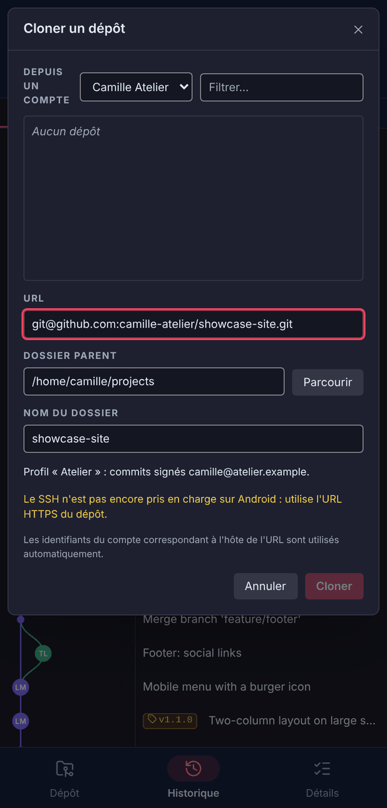 | 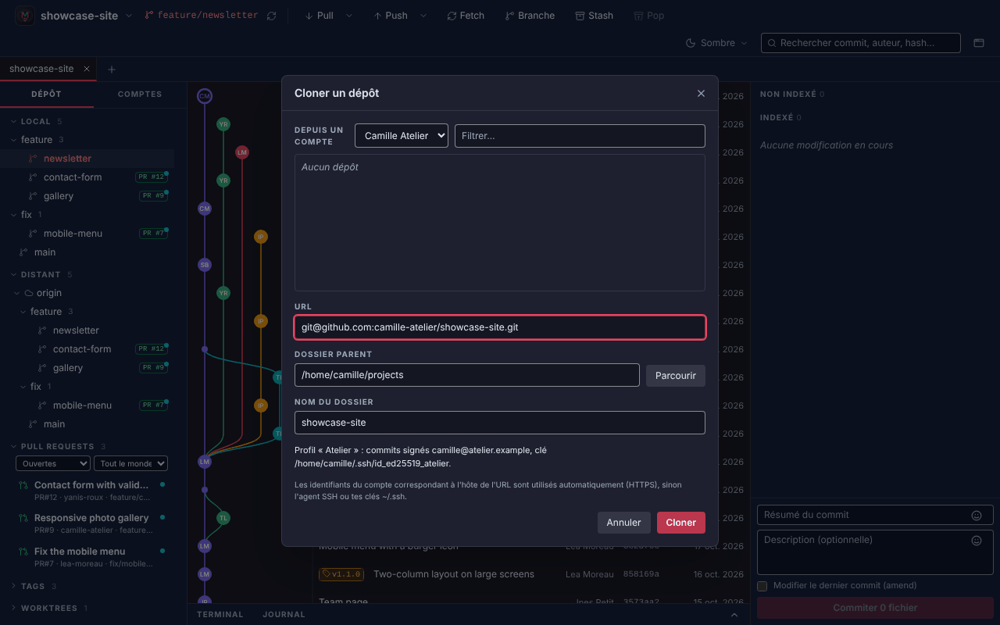 |
|  | 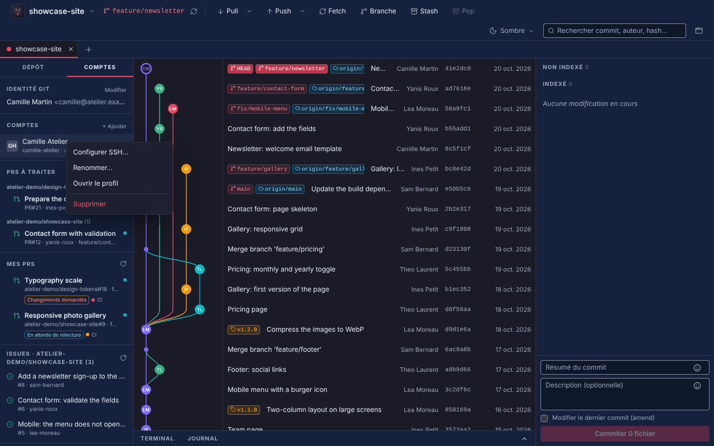 |
|  | 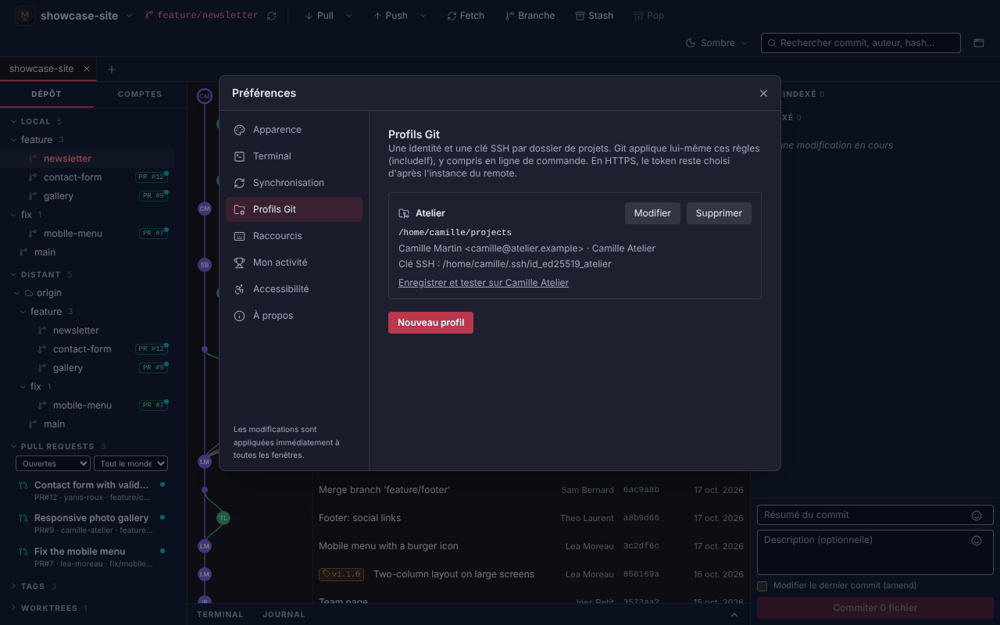 |

- Clone : URL SSH bloquée, y compris `git+ssh://` et `ssh+git://` ; plus d'exemple d'URL SSH ni de clé du profil affichée.
- Comptes : pas de « Configurer SSH… » (inchangé).
- Profils Git : ni choix de clé (inchangé), ni ligne « Clé SSH : clés par défaut », ni bouton « Enregistrer et tester » ; le texte d'aide ne parle plus de clé SSH.
- Backend : sur Android, aucune clé n'est jamais écrite dans un fichier ; l'authentification n'utilise ni fichier de clé ni agent. Sans clé d'appareil, un remote SSH ajouté à la main échoue avec « Le SSH n'est pas encore pris en charge sur Android : utilise l'URL HTTPS du dépôt » ; avec une clé, le message mène à la validation de l'hôte.

## SSH expérimental sur Android (clé de l'appareil)

Captures de la vraie interface, backend simulé (données fictives) :


| Préférences > SSH | Clé créée | Configurer SSH… | Terminé | Clone en SSH |
|---|---|---|---|---|
| 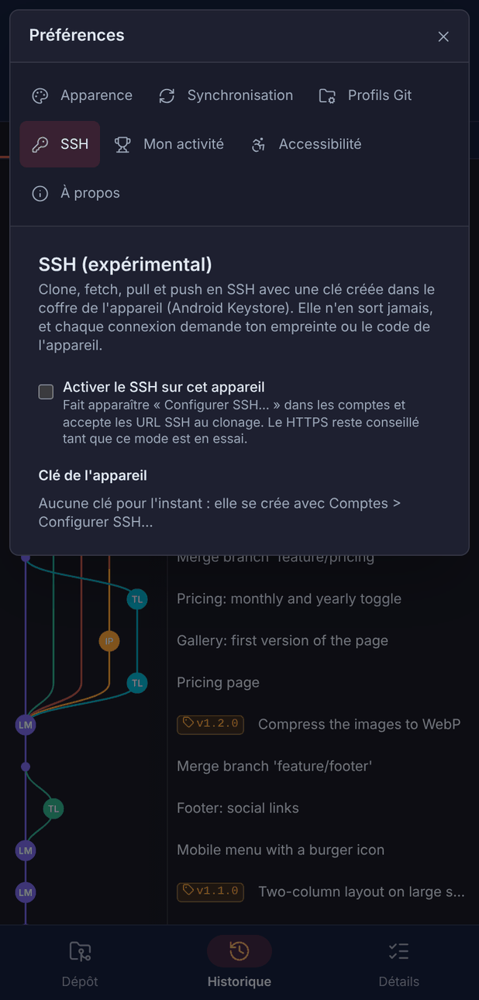 | 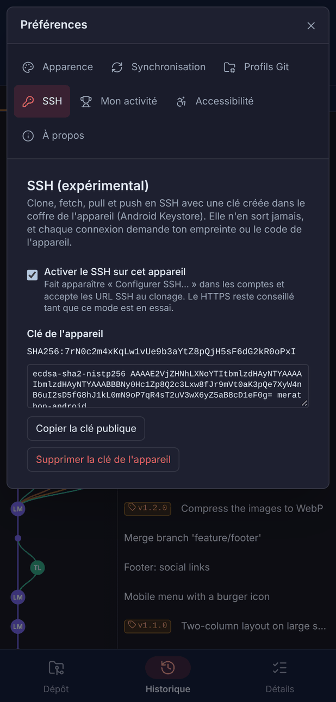 | 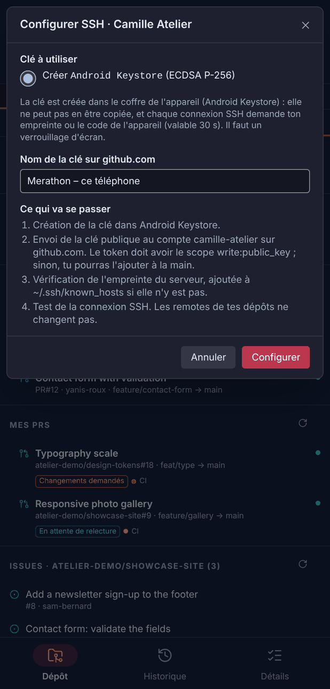 | 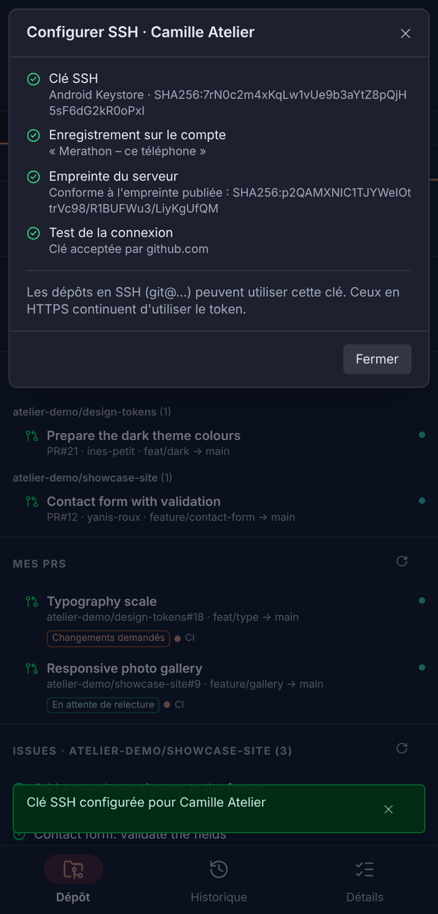 | 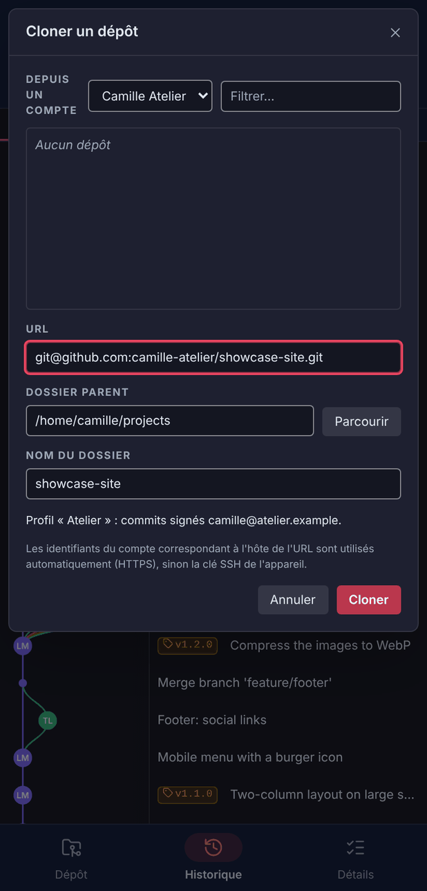 |

## Vérifié sur l'émulateur

Le 5 novembre 2026, APK de debug x86_64 sur un émulateur Pixel (Android 17, API 37), contre un faux GitHub local et un serveur git SSH (paramiko) joints par `adb reverse` (le port 22 de l'émulateur renvoie vers le serveur). Code PIN posé avec `adb shell locksettings set-pin`.

| Vérification | Résultat |
|---|---|
| Sans verrouillage d'écran | Message demandant un verrouillage, aucune clé créée |
| Création de la clé dans le Keystore, envoi sur le compte | Clé ECDSA P-256 reçue par le serveur |
| Empreinte du serveur lue par `certificate_check` (`hostkey()`) | Identique à celle du serveur ; validation manuelle (instance auto-hébergée) |
| Test de connexion, clone, fetch, pull, push en SSH | Signatures acceptées ; une confirmation couvre 30 s, puis elle est redemandée |
| Confirmation annulée (touche Retour) | Arrêt propre, « Confirmation annulée », dépôt inchangé |
| Synchronisation avec la clé verrouillée | Aucune fenêtre (`allowPrompt=false`), un seul message |
| Clé d'hôte modifiée | Connexion bloquée avant toute signature, `known_hosts` intact, rien proposé |
| Dossier de l'application (`run-as`) | `.ssh` ne contient que `known_hosts` ; aucune clé privée nulle part |
| Port fermé / port muet | Erreur immédiate / abandon après 120 s, message « le serveur SSH ne répond pas » |
| Verrouillage d'écran retiré puis remis | Android **efface** la clé (état « absent », pas « invalidée ») ; une nouvelle clé fonctionne |

Corrigé à cette occasion :

- La permission `android.permission.USE_BIOMETRIC` manquait au manifeste : `BiometricPrompt.authenticate` levait une `SecurityException` sur Android 11 et suivants, transformée en « Confirmation annulée ». Le SSH ne pouvait donc jamais aboutir. Une fenêtre impossible à afficher est désormais journalisée et signalée comme telle (code `prompt`).
- Sans clé utilisable, le message n'affirme plus que le SSH n'est pas pris en charge : il dit pourquoi (aucune clé, clé effacée avec le verrouillage d'écran, pas de verrouillage) et quoi faire.
- Délai SSH dépassé : le message parle du réseau, plus de la clé.
- « Configurer SSH… » : une clé d'hôte modifiée fait échouer l'étape « Empreinte du serveur » (préfixe `ssh-host-problem`), au lieu de la laisser cochée.

## Reste à faire sur un appareil

Avant de retirer les garde-fous (étape 8 de l'issue), sur un vrai téléphone arm64, avec le réglage « SSH (expérimental) » coché (les points vérifiés sur l'émulateur sont à refaire rapidement) :

1. Build release (R8), puis `git restore git-client/src-tauri/gen/schemas/acl-manifests.json` avant de commiter.
2. Comptes > Configurer SSH… sur les vrais GitHub et GitLab : empreinte conforme à `PUBLISHED_FINGERPRINTS`, « Clé acceptée ».
3. Confirmation par empreinte digitale (l'émulateur n'a servi qu'avec le code), et application mise en arrière-plan pendant la demande.
4. Android 7 à 10 : écran de déverrouillage du système à la place de `BiometricPrompt` (aucune image de ces versions n'était installée).
5. Clé réellement « invalidée » (et non effacée) sur les appareils qui la gardent : message, suppression dans Préférences > SSH, nouvelle clé.
6. Sous-modules et worktrees d'un dépôt cloné en SSH.

Ensuite : retirer le réglage et les garde-fous, et compléter le Mémo Git (rubrique sur les clés SSH).
